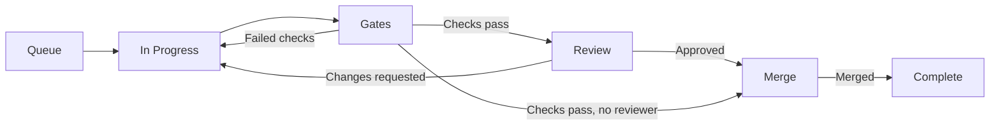

# Pyxie

Pyxie is a local kanban board for coding agents. Queue a card, choose its worker and optional reviewer, and start the pipeline. Pyxie runs the work in Docker, checks the resulting commit, and merges it into the project's target branch.

## How the agent loop works



The worker implements the card on its branch. If a gate fails, Pyxie sends the card back to **In Progress** with the failing output in the worker’s next briefing. If the gates pass but the reviewer requests changes, the reviewer’s findings go back to the worker the same way.

Each revision goes through the gates again. On the next review, the reviewer gets the worker’s handoff, the new gate results, and the previous rejection so it can check whether the revision addressed its findings. Pyxie merges once the same commit clears all required checks. If the card uses its last attempt, it returns to the **Queue** in error for a person to retry.

## Features

| Feature | What you can do |
| --- | --- |
| Local MCP server | Connect an external agent to browse code and diffs, queue cards, read round reports, and retrieve attachments. [MCP tools and examples](docs/mcp.md) |
| Workers and reviewers | Assign Claude Code, Codex, DeepSeek Harness, or a custom command per card. Choose account or API-key authentication for each supported harness. |
| Gates and merges | Require builds, tests, or linters to pass before review. If a merge conflicts, the merge agent or card's worker resolves it, then the resolution goes through the checks again. [Pipeline](docs/pipeline.md) |
| Card history and media | Attach reference files to a card and inspect reports, screenshots, or recordings from individual rounds, including failed attempts. Capture tools come from the project image. [Card media](docs/media.md) |
| Project repositories | Import a local folder or URL into a project-local bare Git repository called the hub. Clone, pull, or push to the hub, browse branches and history, or download a branch as a ZIP. |
| Sandboxes and settings | Customize the project Dockerfile and transfer agents, ordered gates, category colors, and sandbox settings between projects. [Sandboxes](docs/sandboxing.md) · [Settings files](docs/settings-file.md) |

## Run locally

### Install a release

1. Install Git and confirm that `git --version` works in your terminal.
2. For the pipeline, install and start Docker Desktop on Windows or macOS, or Docker Engine with the Docker CLI on Linux. On Windows, select Linux containers. Run `docker info --format '{{.OSType}}'` as the user who will run Pyxie and check that it prints `linux`.
3. Download the ZIP for your operating system and processor from [GitHub Releases](https://github.com/Mythikos/pyxie/releases) and extract it. The ZIP includes the .NET runtime.
4. Open a terminal in the extracted folder. Run `.\Pyxie.Web.exe` on Windows or `./Pyxie.Web` on macOS and Linux. Open the URL printed at startup.

### Run from source

```shell
dotnet run --project src/Pyxie.Web
```

Open the URL printed at startup. The included `http` launch profile defaults to <http://localhost:5280> and runs in the Development environment. Pyxie applies database migrations at startup.

**First card.** Import a repository on the Repository page, configure a worker in Settings, and add a card to the Queue. The pipeline starts stopped on each launch. Start it from the header. Blocked cards and cards that exhaust their attempts return to the top of the Queue for retry (five attempts by default).

### Agent setup

Agents run unattended in their sandbox, which is the boundary, so their arguments run the harness in print mode with every permission: `-p --dangerously-skip-permissions` for Claude Code and `exec --dangerously-bypass-approvals-and-sandbox --skip-git-repo-check` for Codex. All harnesses receive the prompt on standard input.

In Settings → Agents, select **Account** or **API key** for Claude Code, Codex, or DeepSeek. For an account, save the token from `claude setup-token` in `secrets\claude-oauth-token`, sign into Codex with ChatGPT using `codex login` and file storage, or sign into DeepSeek with `dsh web`. For an API key, save the provider key in `secrets\anthropic-api-key`, `secrets\openai-api-key`, or `secrets\deepseek-api-key` under the workspace root. Settings → Sandbox shows which credentials are present. If both are available, the agent uses the selected method. A missing selected credential blocks the round.

## Connect an MCP client

To connect a local external agent, open **Settings → Global**, enable MCP access, and copy the displayed Streamable HTTP endpoint into the client. This applies to all projects and works before opening one. See [external agent setup and workflows](docs/mcp.md).

## Configuration

Set in `src/Pyxie.Web/appsettings.json`, an environment-specific file, or environment variables (for example `Workspace__Root`).

| Key | Default | Purpose |
| --- | --- | --- |
| `Database:Provider` | `Sqlite` | Database provider. Unknown values fail at startup |
| `Pipeline:Workers` | `5` | Cards that run at once (1-32) |
| `Pipeline:RoundTimeoutMinutes` | `60` | How long an agent may run in one round (1-1440) |
| `Pipeline:PollIntervalSeconds` | `5` | How often idle workers look for work (1-300) |
| `Workspace:Root` | `%LOCALAPPDATA%\Pyxie` | Where Pyxie keeps its data: the machine database (`pyxie.db`, the list of projects), the sign-ins agents' sandboxes get (`secrets`), and one folder per project under `projects` (its database, hub, the host side of its card sandboxes, and round logs). Keep it outside every repository |
| `AllowedHosts` | `localhost;127.0.0.1;[::1]` | Host names the app answers to. Pyxie has no sign-in and runs commands, so it only answers local names, which stops other web pages reaching it through DNS rebinding |
| `Blazorise:ProductToken` | empty | Optional Blazorise product token; keep it in user secrets or an environment variable, not source control |

## Develop

```
dotnet build -warnaserror
dotnet test
dotnet format --verify-no-changes
```

See [AGENTS.md](AGENTS.md) and [docs/coding-standards.md](docs/coding-standards.md).
